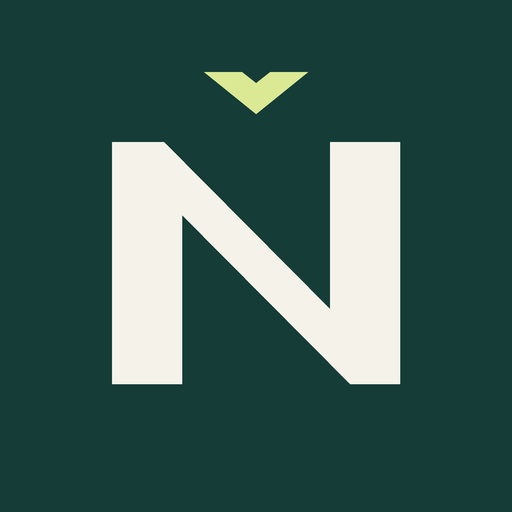
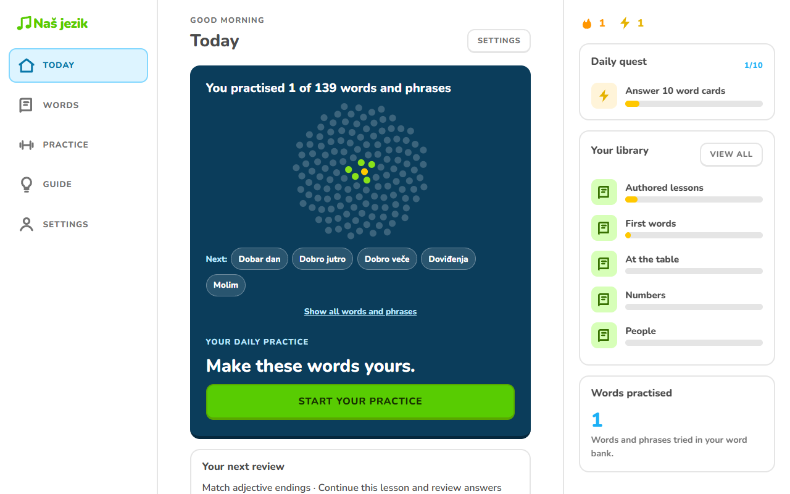
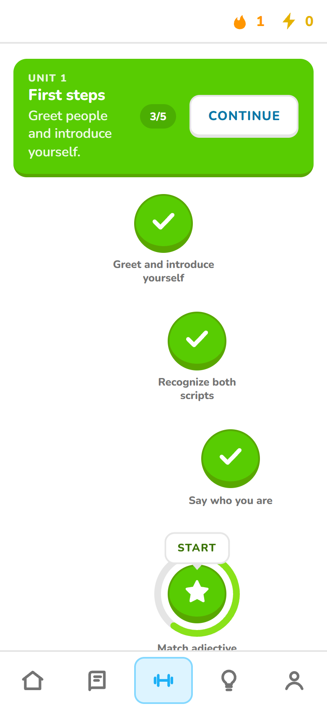
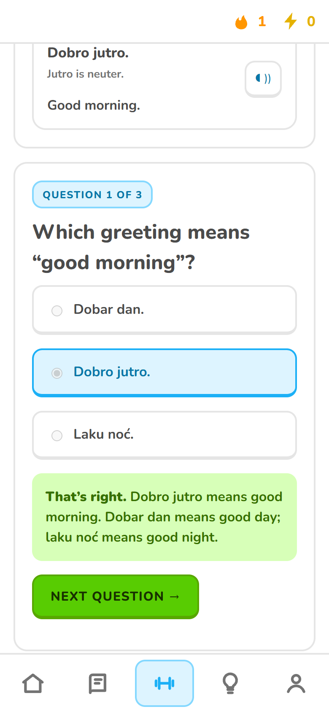
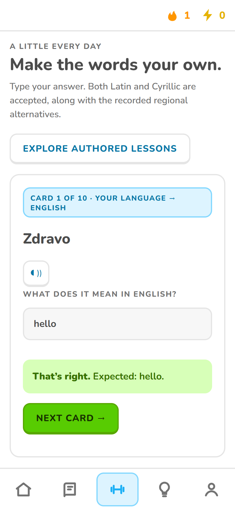
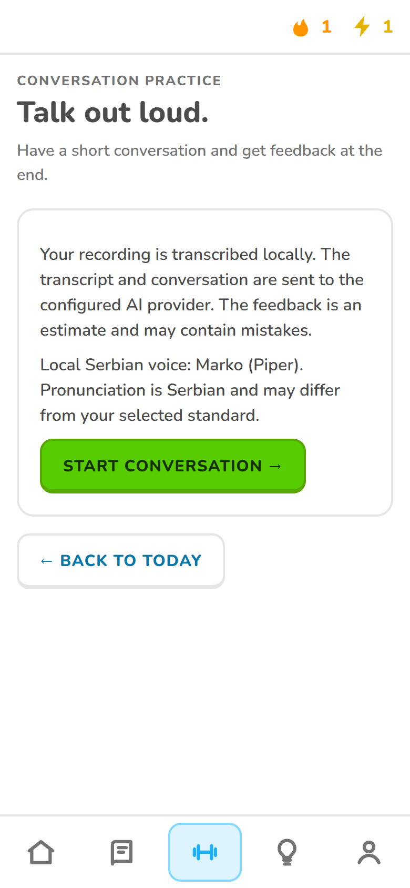

<p align="center">
  
</p>

<h1 align="center">Naš jezik</h1>

<p align="center">
  A friendly, Duolingo-style course for learning Serbo-Croatian.<br>
  Montenegrin, Serbian, Croatian and Bosnian, in Latin or Cyrillic.<br>
  Runs on your own computer. Your progress stays with you.
</p>

<p align="center">
  
</p>

## What you can do

- **Follow a lesson path.** Short lessons unlock one after another.
- **Practise words every day.** Type the meaning. Latin and Cyrillic both count.
- **Hear it spoken** by a local Serbian voice.
- **Talk out loud** with an AI partner and get feedback at the end.
- **Get writing help** and ask the tutor questions.
- **Add your own words**, or pull them from a song or text you like.
- **Use it on your phone** over your home Wi-Fi.

<p align="center">
  
  
  
  
</p>

## Get started

You need [Python 3.11+](https://www.python.org/downloads/).

```bash
git clone https://github.com/eskopelitis/Serbo-Croatian-Duolingo-.git
cd Serbo-Croatian-Duolingo-
python -m pip install -r requirements.txt
python app.py
```

Then open **http://127.0.0.1:5000** in your browser.

Lessons and word practice work right away. Nothing else is needed.

## Optional extras

Open **Settings → AI & speech setup** on the computer running the app (setup is locked on phones), or follow the steps below.

| Extra | What it adds | How |
|---|---|---|
| AI key | Tutor, Talk, writing help, word extraction | Paste a [DeepSeek](https://platform.deepseek.com) key in Settings, or copy `.env.example` to `.env` and fill in `DEEPSEEK_API_KEY` |
| Serbian voice | Hear every word and sentence | `python tools/setup_sc_voice.py` (about 64 MB) |
| Speech recognition | Speak your answers in Talk | Install CrispASR with a Whisper model (paths in `.env.example`) |

No AI key? A local [LM Studio](https://lmstudio.ai) server running `openai/gpt-oss-20b` works as a backup.

## Use it on your phone

1. Start the app with `run.cmd` (Windows). It turns on HTTPS, which phones need for the microphone.
2. The terminal prints an address like `https://192.168.1.20:5000`. Open it on your phone.
3. On iPhone, open `/cert` once to install the app's certificate, then add the page to your home screen.

Your phone and computer must be on the same Wi-Fi.

## Your data

- Progress is saved in `song.sqlite3` in this folder. A daily backup goes to `data/backups/`.
- Your AI key is stored outside this folder, encrypted for your Windows account.
- If you add an AI key, the text you send to the tutor, Talk or writing help goes to that provider.

## Good to know

- Pick your standard (Montenegrin, Serbian, Croatian or Bosnian) and script in **Settings**. The app shows your preferred form first and lists the others.
- The voice speaks Serbian. Pronunciation may differ from the standard you picked.
- AI feedback can be wrong. Treat it as a helpful hint.
- Port 5000 busy? Run `set SONGTOLEARN_PORT=5001` (PowerShell: `$env:SONGTOLEARN_PORT='5001'`) before `python app.py`.

## For developers

Plain Flask, SQLite and vanilla JavaScript, with no build step.

```bash
python -m unittest discover -p "test_*.py"
node --test test_sc_lessons_frontend.cjs test_sc_voice.cjs
```

Browser checks (need `pip install -r requirements-dev.txt` and Microsoft Edge): `python tools/verify_sc_roadmap.py`, `verify_sc_setup.py`, `verify_sc_talk.py`.

Sources, licenses and research notes are in [SERBO_CROATIAN_RESEARCH.md](SERBO_CROATIAN_RESEARCH.md) and [research/](research/).

## Credits

- Example sentences from [Tatoeba](https://tatoeba.org) (CC BY 2.0 FR). Contributors are linked inside the app.
- Serbian voice: [Piper](https://github.com/rhasspy/piper) with the [Marko model](https://huggingface.co/phantom9623/piper-serbian-tts).
- Lesson path layout adapted from [sanidhyy/duolingo-clone](https://github.com/sanidhyy/duolingo-clone) (MIT).

Naš jezik is an independent project and is not affiliated with Duolingo.
